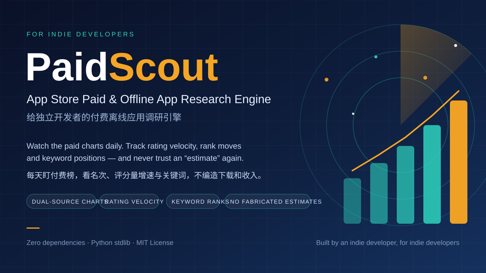

# PaidScout

**English** | [简体中文](README.zh-CN.md)

**App Store paid & offline app research engine for indie developers.**

PaidScout watches the App Store paid charts every day and turns them into
research an indie developer can act on: which paid, offline, single-device
apps are actually moving, which new entries are real, and where a one-person
team could still build something people pay for.

It replicates the replicable core of what Qimai / Sensor Tower / data.ai do —
scheduled chart crawling, rank history, rating-velocity tracking, keyword
positions — using **only Apple's official free feeds. No API key, no
subscription, no scraped login-walled data.**

> **Honesty first:** PaidScout never prints download or revenue "estimates".
> Those numbers at big platforms are panel-calibrated models — directional at
> the top of the charts, demonstrably broken in the long tail (we caught a
> major platform showing $0 revenue for an app selling ~260 copies/day).
> PaidScout reports the verifiable signals themselves: rank, rank movement,
> rating-count delta, price, version cadence, keyword positions.
> See [docs/METHODOLOGY.md](docs/METHODOLOGY.md).

## Features

- **Dual-source charts** — Apple legacy RSS *and* MarketingTools RSS, US & CN
  storefronts, paid + grossing, overall and per-genre (Games, Utilities,
  Productivity, Education, Graphics & Design, Photo & Video). The two
  official feeds often disagree (top-50 overlap was ~36% on 2026-11-07);
  PaidScout stores them separately and flags it instead of merging ranks.
- **History & diffs** — everything lands in SQLite. Every run after the first
  reports rank changes, new entries, **rating-count deltas** (the honest
  download-velocity proxy), price and version changes.
- **Watchlist tracking** — keyword search positions and recent-review velocity
  for the apps you care about (your candidates — and your own app).
- **First-pass filters** — offline/single-device heuristics from store copy,
  and a big-company flag, so solo-dev-replicable apps stand out from
  Mojang/Warner/Tencent-scale hits. Heuristics are labelled as such.
- **Zero dependencies** — one Python file, standard library only.

## Quickstart

```bash
git clone https://github.com/Qson8/paidscout.git
cd paidscout
python3 paidscout.py            # full run, ~90 seconds
python3 paidscout.py --quick    # overall charts only, faster
```

Output: a Markdown report in `reports/report-YYYY-MM-DD.md` and history in
`data/monitor.db`. Run it daily (cron/launchd/GitHub Actions) and the reports
start carrying day-over-day deltas from day two.

## Configuration

Everything lives in code defaults; override with a JSON config:

```bash
cp config.example.json config.json   # edit countries, keywords, watchlist
python3 paidscout.py --config config.json
```

The watchlist is a list of `[app_id, country, label]` — the same app can be
tracked in several storefronts. Keywords are tracked per storefront; an app
only appears in the keyword section if it ranks in the top 50 for a tracked
keyword.

## Sample output

[examples/sample-report-2026-11-07.md](examples/sample-report-2026-11-07.md)
is a real first run: US & CN paid top-50s, cross-source disagreement flags,
keyword hits (e.g. a chart-topping camera app that ranks only #43 for its own
core keyword — external buzz, not store search), and watchlist review probes.

## Use it with an AI agent (Skill)

This repo ships an installable agent skill in [`skill/SKILL.md`](skill/SKILL.md).
Give it to your agent (Muse, Claude Code, or any SKILL.md-compatible
runtime) and the agent can run the whole workflow for you: execute the engine
daily, review its heuristics, score directions on the 5 axes, and maintain
your candidate pool — under the same no-fabricated-estimates rule.

## How a research workflow uses it

PaidScout is the data layer. The workflow it was built for:

1. Run daily; skim new entries and rating-delta outliers.
2. Score candidate *directions* (not clones) on indie replicability, offline
   purity, overseas fit, paid-validation strength, and fit with your stack.
3. Keep a candidate pool; drop directions that leave the charts or stall.

## Roadmap

- Review-probe reliability (some storefront feeds intermittently return 0)
- Per-app detail pages (IAP list, description diffing between versions)
- Optional Qimai/Sensor Tower cross-check importer for manual spot checks
- Sparkline-style rank history export (CSV)

## License

MIT. Built by an indie developer, for indie developers.
Data is fetched from Apple's public feeds; respect their terms and rate
limits (the engine batches lookups and sleeps between calls).
